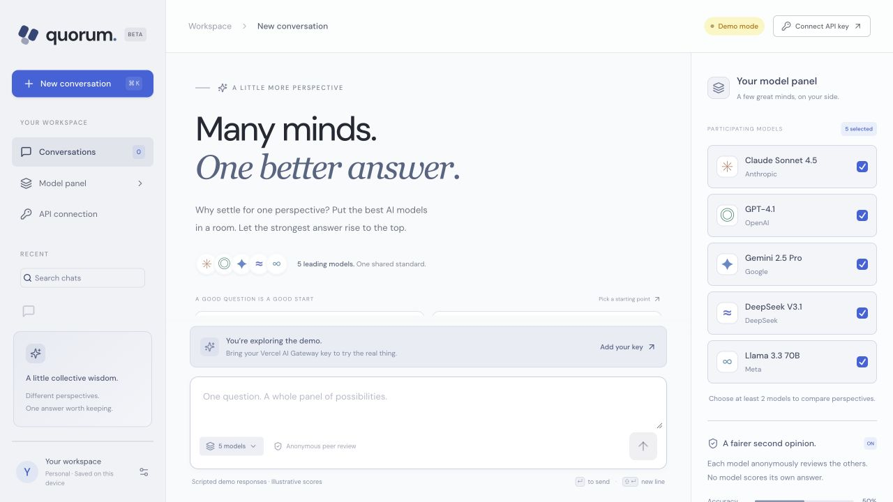

# Alona Pakhniuk

Senior Frontend Engineer in San Francisco with 9+ years of experience building production web applications with **React, TypeScript, and Next.js**.

I build customer-facing interfaces, reusable components, and shared frontend tooling. My experience includes leading two developers on a website and online booking experience for a 22-clinic veterinary network, and building component libraries and API tooling used by multiple teams.

My current projects explore AI interfaces: parallel model responses, anonymous peer evaluation, photo review, and editable shopping plans. I use AI coding tools alongside code review and automated checks.

**[Portfolio](https://www.alona-portfolio.dev/)** | **[LinkedIn](https://www.linkedin.com/in/alona-pakhniuk)**

## Selected projects

### Quorum — Multi-Model AI Chat

One prompt, multiple model responses, and anonymous peer reviews. Includes model selection, streamed responses, cancellation, and browser-local conversation history.

**Next.js · React · TypeScript · Vercel AI SDK** · [Try the demo](https://quorum-multi-llm-chat.vercel.app/)

The public demo uses scripted responses and illustrative scores. Live mode uses the visitor's Vercel AI Gateway key. Source code is private.

### Pixora — Photo Review

Groups similar photos in the browser and suggests the best shot using local sharpness and exposure checks. Includes a server-side OpenAI integration, Playwright tests, and a SwiftUI iPhone prototype.

**React · TypeScript · Vite · Node.js · Playwright** · [Source and setup](https://github.com/pakhniuk/pixora-app)

Local prototype. Successful live AI comparison is not yet verified; the README documents test coverage and limitations.

### codine — GitHub Code Counter

A Next.js application that estimates additions and deletions in public repositories, with GitHub OAuth, server-side token handling, partial-result reporting, and Jest / React Testing Library tests.

**Next.js · TypeScript · GitHub API · Auth.js** · [Source](https://github.com/pakhniuk/codine) · [App](https://codine.vercel.app)

### Gather — Shopping Planner · In development

An interactive shopping planner demo with editable product lists, quantity controls, substitutions, and budget tracking. AI integration is in progress; demo products and prices are fictional.

**Next.js · TypeScript** · [Try the demo](https://gather-ai-shopping-planner.vercel.app/)

## Interface experiments

- **[moodify](https://github.com/pakhniuk/moodify)**: Mood-based song picker with a YouTube player. [Demo](https://moodify-ten-phi.vercel.app)
- **[omi](https://github.com/pakhniuk/omi)**: Interactive canvas creature with spring physics. [Demo](https://omi-ghost.vercel.app)
- **[easee](https://github.com/pakhniuk/easee)**: Playground for comparing animation easing functions.
- **[404](https://github.com/pakhniuk/404)**: 3D "not found" scene built with Three.js. [Demo](https://404-cyan.vercel.app)
